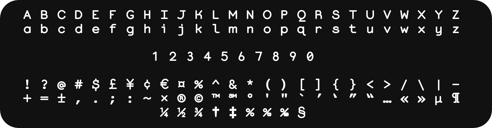
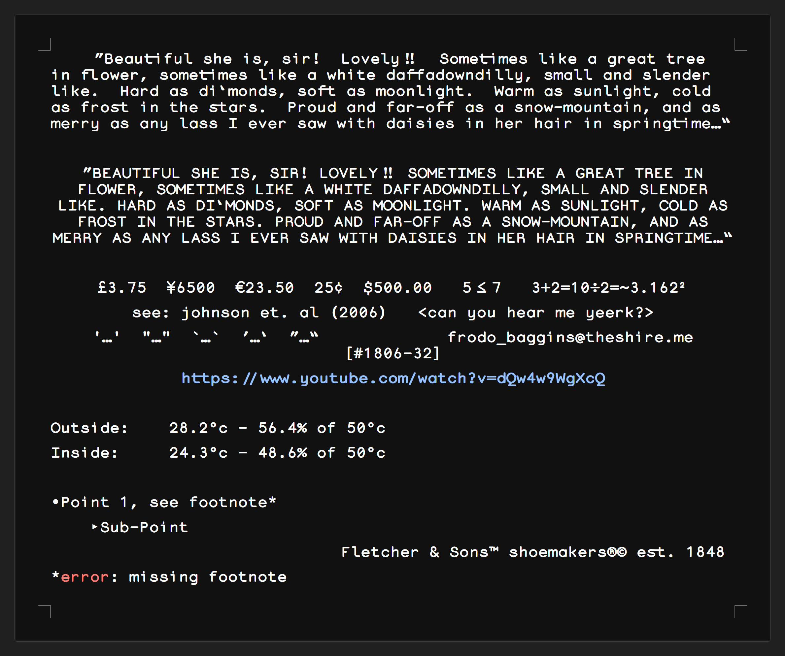
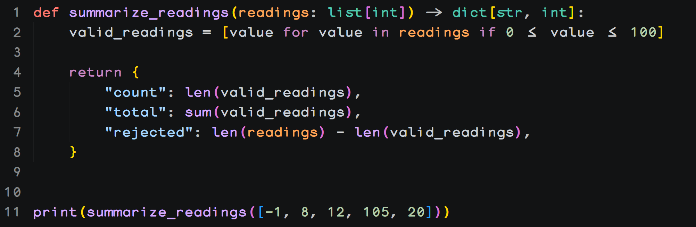
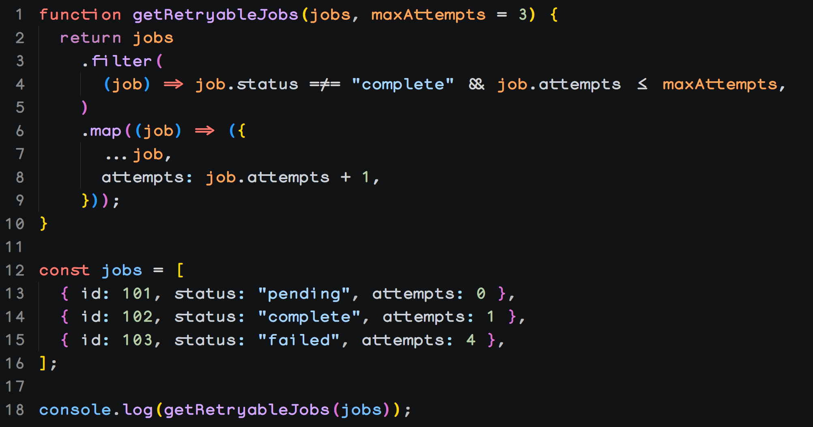
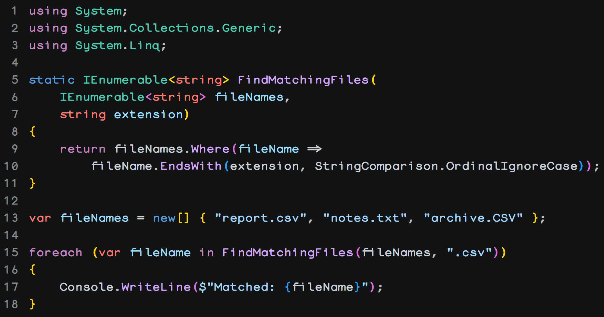
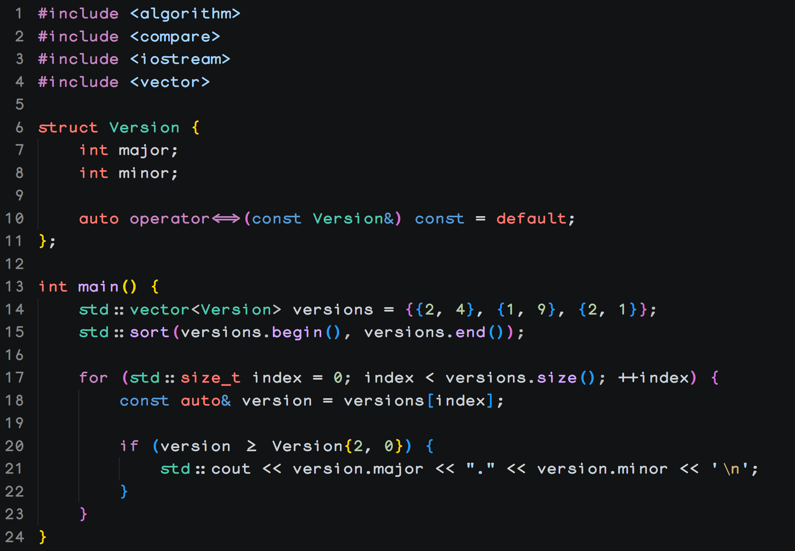
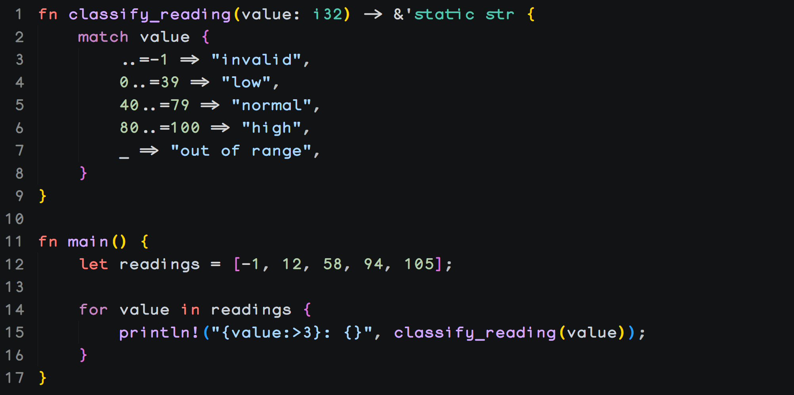

# Geomex Mono

Geomex Mono is a pair of two geometric monospaced typefaces with rounded terminators. It is based on (mostly) perfect circles and straight lines. It features extensive ligatures for coding and latin glyph combinations. The rounded terminators and thick strokes make it legible at small scale and give it a friendly appearance.

Geomex comes in two varieties - a gothic (sans-serif) and a roman (seriffed) version.

[Download Geomex Mono Gothic (TTF)](./geomex_gothic.ttf?raw=true)
[Download Geomex Mono Roman (TTF)](./geomex_roman.ttf?raw=true)

## Samples

### Glyphs

### Textual Sample

### Coding

#### Python

#### Javascript

#### C#

#### C++

#### Rust

## Installation

Download the **TTF** and install it with your system's font installer. Enable Opentype ligatures in your text editor to enjoy the ligature support.

## License

Copyright © 2026 Dieter "squink" Stassen. The font is available under the [SIL Open Font License 1.1](./OFL.txt). See the [OFL FAQ](https://openfontlicense.org/ofl-faq/) for information on using and redistributing the font.
